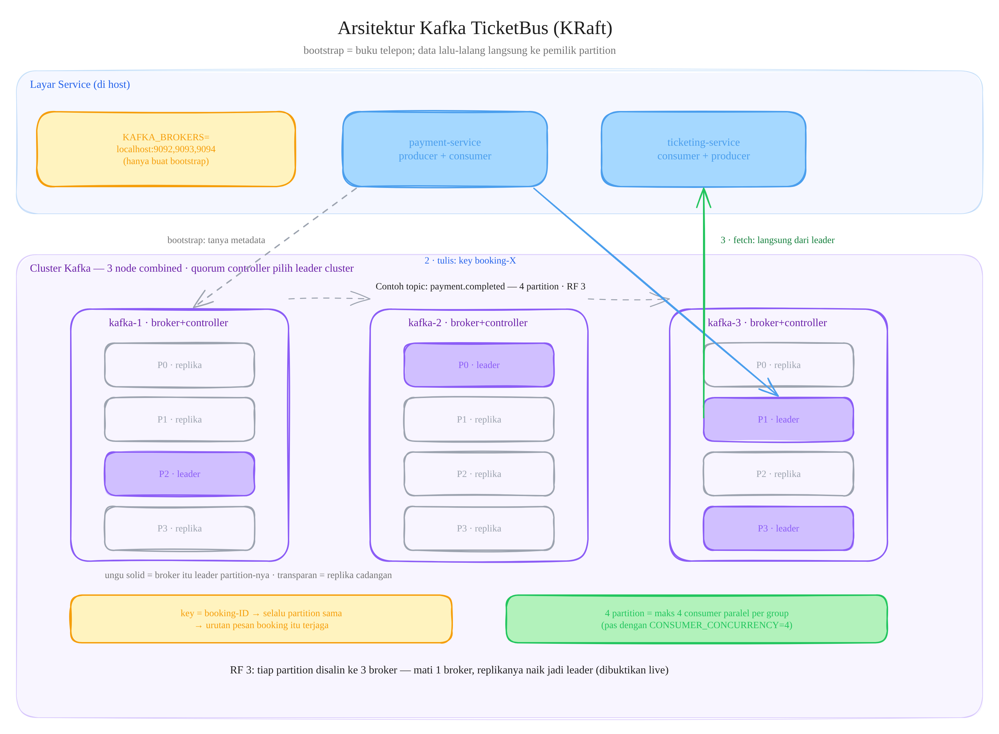

# TicketBus

A ticketing platform built with Go microservices, Kafka, PostgreSQL, Traefik, and Next.js.

## Architecture

```
Browser (Next.js :3000)
  │
  ▼
Traefik (:8000) — CORS, rate-limit, forward-auth (→ auth:8081/api/auth/verify)
  │
  ├─ /api/auth/*                  → auth-service     :8081  (JWT, RBAC, registration)
  ├─ /api/events/*                ┐
  ├─ /api/admin/events/*          ┘→ ticketing-service :8082  (events, approvals, reservations, bookings)
  └─ /api/payments/*              → payment-service   :8083  (transactions, gateway sessions, webhooks)

Services communicate asynchronously via Kafka (3 KRaft brokers, RF=3, 4 partitions per topic):
  ├─ event.cancelled    ticketing → ticketing (cancel cascade) + payment (refund requests) + mail (booker notification)
  ├─ payment.completed  payment   → ticketing (confirm booking, issue tickets)
  ├─ payment.expired    payment   → ticketing (expire booking, release seats)
  ├─ ticket.issued      ticketing → mail (e-ticket email per booking item)
  ├─ payout.requested   ticketing → payment (prepare an event payout)
  ├─ payout.completed   payment   → ticketing (settle event payout status)
  └─ refund.completed   payment   → mail (refund settled or failed notice)

Reserve → payment handoff is asynchronous too, but over REST (never Kafka):
  └─ payment.initiate   ticketing → payment (outbox row → background REST dispatcher
                          → POST /api/payments/internal; payment idempotent per booking_id)

Payout → gateway uses the same outbox-rest pattern inside payment:
  └─ payment.disbursement payment → Xendit Payouts API (outbox row → payout REST dispatcher)

Seat availability is authoritative in PostgreSQL:
  └─ ticket_types.available_seat — atomic seat counter (conditional UPDATE ... WHERE available_seat >= qty)

Reservation expiry lives in the payment service, split by who owns the session:
  └─ gateway webhook payment_session.expired (transaction has a live session)
  └─ in-process expiry sweeper, EXPIRY_POLL_SEC (no session was ever created,
     or the webhook never arrived)
```

### Kafka cluster internals

The `KAFKA_BROKERS` list is only a bootstrap "phone book" — after the one-time
metadata handshake, producers and consumers talk directly to each partition's
leader broker. Topic partition/leader layout below matches a live
`kafka-topics --describe` output.



## Roles

| Role | Capabilities |
|------|-------------|
| `customer` | Browse published events, reserve tickets, pay via gateway, view own bookings |
| `eo` (organizer) | Create events (pending), view own events, update/cancel own events, reprocess cancellation |
| `admin` | Approve/reject pending events, view all events, cancel/reprocess any event, seeded from `ADMIN_SEEDS` |

## Transactional Outbox

All inter-service communication flows through the **transactional outbox pattern** — each service writes domain events to an outbox table in its own database within the same transaction as the business data. Two workers share the table, partitioned by topic:

- **Kafka worker** (`pkg/outbox.Worker`) — polls every `OUTBOX_POLL_MS` (200ms), publishes undelivered rows in batches of 100 to an **allow-listed set of Kafka topics**, marks them `delivered=true`.
- **REST dispatcher** (ticketing only, `internal/payment.Dispatcher`) — polls `payment.initiate` rows every `REST_DISPATCH_POLL_MS` (200ms) and POSTs each payload to the payment service's `POST /api/payments/internal`, marks `delivered=true` on any 2xx. Failed batches back off 1s. `payment.initiate` is never published to Kafka, and the Kafka worker never touches it.

```
┌──────────────┐     ┌──────────────┐     ┌────────────────┐
│  Business Tx │────▶│ Outbox Table │────▶│ Kafka Worker   │──▶ Kafka (allow-listed topics)
│ (atomic)     │     │ (same DB)    │     │ REST Dispatcher│──▶ POST /api/payments/internal
└──────────────┘     └──────────────┘     └────────────────┘
```

| Service | Produces via Outbox | Consumes |
|---------|-------------------|----------|
| Auth | — | — |
| Ticketing | `event.cancelled`, `ticket.issued`, `payout.requested` (Kafka), `payment.initiate` (REST dispatch) | `payment.completed`, `payment.expired`, `payout.completed` |
| Payment | `payment.completed`, `payment.expired`, `payout.completed` (Kafka), `payment.disbursement` (REST dispatch) | `event.cancelled`, `payout.requested` |

This guarantees **at-least-once delivery** and eliminates the dual-write problem (no DB write that can succeed while the REST/Kafka write fails). Consumers are idempotent via guarded status transitions (`TransitionIfActive`, `UpdateStatusIfPending`), so a redelivered message is a no-op instead of a double write. The same holds across the REST hop: the payment service upserts on `booking_id` (201 `created=true` on first insert, 200 `created=false` on redelivery — both 2xx, so the dispatcher treats either as delivered).

## Services

| Service | Language | Port | Database | Responsibilities |
|---------|----------|------|----------|-----------------|
| `auth-service` | Go | 8081 | `auth_db` (5432) | Customer/organizer registration, login, JWT (access 15m, refresh 7d), Traefik ForwardAuth `verify`, organizer profiles, admin seed from `ADMIN_SEEDS` |
| `ticketing-service` | Go | 8082 | `ticketing_db` (5433) | Event CRUD, admin approval workflow, live seat counters, reservation holds (`RESERVATION_TTL`), booking transitions, cancel cascade, organizer payout accounts + per-event payouts, outbox: `event.cancelled`, `ticket.issued`, `payout.requested` (Kafka) + `payment.initiate` (REST dispatcher → payment) |
| `payment-service` | Go | 8083 | `payment_db` (5435) | Transaction lifecycle (`initiated → pending → completed \| expired`), gateway session creation via pluggable `mock`/`xendit` processor, webhook ingestion, expiry poller, refund requests + executor (Payouts API to the customer's registered refund destination), event payout aggregation + Xendit Payouts API, outbox: `payment.*`, `payout.completed`, `refund.completed` |
| `mail-service` | Go | 8084 | — (stateless) | Consumes `ticket.issued` (e-ticket per item), `event.cancelled` (booker notice + refund-account CTA) and `refund.completed` (payout sent / needs a corrected destination); sends over SMTP (MailDev in dev); no database |
| `web` | Next.js 16 | 3000 | — | TanStack Query data fetching, `proxy.ts` route guards, ticket-stub UI, toasts, ConfirmDialog, Tooltip, SSR homepage |

All amounts are stored and sent to the gateway as whole rupiah integers (`amount_rupiah`, `price_rupiah`, currency `IDR`) — no minor-unit conversion anywhere in the payment path.

## Event Lifecycle

```
EO creates event → status=pending
  ↓
Admin approves → status=published + seat counters initialised per ticket type (synchronous)
  ↓
Customer browses → GET /api/events (published only)
  ↓
Customer reserves → POST /api/bookings/reserve
    ONE DB transaction: seats decremented (atomic UPDATE), booking created
    (status=pending, expires_at = now + RESERVATION_TTL), outbox row payment.initiate
    → background REST dispatcher calls POST /api/payments/internal (idempotent per booking_id;
      the frontend may see 404 "transaction not found" for the first few hundred ms and shows a
      wait/Refresh state until it lands)
  ↓
Customer pays → POST /api/payments/booking/{booking_id}
    gateway session created (status=pending, provider_ref + payment_link_url stored)
    → frontend opens the hosted payment page in a new tab and polls GET /api/payments/booking/{booking_id}
  ↓
┌─ payment_session.completed  → status=completed → outbox: payment.completed → booking confirmed → ticket.issued per item
└─ payment_session.expired    → status=expired   → outbox: payment.expired   → booking expired, seats released
  ↓
After end_at passes, the organizer can request a payout for the event
    (see Event Payouts below)
```

`ProcessPayment` creates the gateway session with the transaction's own deadline (`expires_at`), so the session and the seat hold always end together and a customer can never pay after their seats were released. It refuses to start a session unless more than 10 minutes remain — the gateway's minimum session lifetime — so Xendit never receives a session it would reject. A session can only be created once: the `initiated → pending` transition is guarded, so a duplicate call returns `409` and voids the orphaned gateway session.

### Reservation window

A ticket can only be reserved while the event is **live**:

```
published  AND  start_at <= now()  AND  now() < end_at
```

- **No presale** — an event that has not started yet cannot be booked.
- **No late booking** — once the event has ended, reservations are closed.
- **A reservation made while the event was live stays payable afterwards.** The
  hold is `RESERVATION_TTL` from the reservation and is *not* clamped to the
  event's end, so a customer who booked at 14:19 of a 14:20 event can still pay
  at 14:30. The gateway session is created with the hold's own deadline and is
  only issued while more than the gateway's ten-minute minimum remains, so a
  payment made inside the hold is always honoured and never outlives the seats.
- With `RESERVATION_TTL=1800` the hold splits into a **20-minute window for the
  customer to start a payment** and a **10-minute gateway session** behind it.
- The hold, not the event's end, is what expires a booking, and two paths do it:
  the gateway's own expiry webhook for a transaction with a live session, and
  the expiry sweeper for one the customer never started (which the gateway
  therefore knows nothing about). Either emits `payment.expired`; ticketing then
  expires the booking and releases the seats. A payment that arrives after the
  hold died is refunded (`late_payment`).
- `RESERVATION_TTL` must therefore exceed the gateway's ten-minute minimum
  session lifetime.
- The check runs twice: the service rejects early with a precise error, and the
  booking insert inside the transaction is conditional on the event still being
  reservable — so an event cancelled in between cannot be booked.
- The public event list only shows live events; organizer and admin views show all.

### Timezones

Timestamps are absolute instants everywhere: the columns are `TIMESTAMPTZ`, the
API speaks RFC3339 with an offset, and every comparison (`start_at <= now`,
`expires_at <= NOW()`, the reservation window) is instant-based — a local wall
clock is never persisted, so the server's timezone cannot shift a result.

The web app renders those instants in the **visitor's own timezone**: the event
form converts the entered local time with `toISOString()`, and the format
helpers use the browser's clock (`LocalTime` for the server-rendered homepage
paints UTC first and switches to the local clock on hydration). An event created
at 15:08 in Jakarta therefore shows as 15:08 in Jakarta and at the reader's
local time elsewhere.

### Reservation expiry (race-safe)

```
Gateway webhook payment_session.expired → HandleSessionWebhook → outbox: payment.expired
Sweeper: in-process, every EXPIRY_POLL_SEC. It owns only what the gateway will never
         report — transactions that never got a session (swept at expires_at) and
         sessions whose webhook is more than PendingExpiryGrace overdue. It cancels
         any live session, marks the transaction expired, and emits payment.expired
         with reason=internal_expiry_fallback
  ↓
Ticketing consumes payment.expired → booking status=expired → seats released

Race: payment.completed and payment.expired may arrive concurrently. Both transitions are
guarded (TransitionIfActive / UpdateStatusIfPending), so exactly one wins and the other is a
no-op — seats are released at most once.
```

A `payment_session.completed` that arrives after the transaction already expired does not confirm
the booking. It opens a late-payment refund instead (see below).

### Event cancel & refund flow

```
EO (or admin) cancels → POST /api/events/{id}/cancel → outbox: event.cancelled
  ↓
Ticketing consumes event.cancelled → cache event status → cancel bookings + release seats
  ↓
Payment consumes event.cancelled → for every completed transaction of that event:
    INSERT refund_requests (status=pending, reason=event_cancelled,
                           idempotency_key='event-cancelled:'||txn_id)
    UPDATE transactions SET refund_status='pending'
    Transactions still initiated or pending are left alone — the customer may still pay, and the
    session expires on its own.
  ↓
Anything that completed after that pass is picked up by a later republish:
POST /api/events/{id}/cancel-reprocess (EO) or POST /api/admin/events/{id}/cancel-reprocess (admin)
  ↓
A payment completed after its transaction already expired never confirms the booking — it opens a
late-payment refund (reason=late_payment) instead
```

Refunds are tracked entirely in the payment service — the bookings table carries no refund column,
and totals are derived from `booking_items.total_price_rupiah`. Customers read their own refunds
from `GET /api/refunds`; nothing is mirrored into ticketing.

| `transactions.refund_status` | Meaning |
|-----------------------------|---------|
| `none` | No refund needed |
| `pending` | Refund owed (event cancelled after payment completed, or late payment) |
| `processing` | The executor claimed it and submitted the payout |
| `succeeded` | Payout confirmed by the provider |
| `failed` | The gateway settled it as failed (`FAILED`, `REVERSED`, `REJECTED`, `CANCELLED`, `EXPIRED`) — retryable from the admin table |

| `refund_requests.status` | Meaning |
|--------------------------|---------|
| `pending` | Refund recorded, not yet sent to the provider |
| `processing` | Payout in flight |
| `succeeded` | Payout confirmed by the provider |
| `failed` | Gateway settled the payout as failed — visible in the admin refund table for retry |

Refund status is owned by the gateway. An admin can only **retry** a failed
refund; there is no manual "reject", because closing a refund by hand would
tell the customer to fix an account their bank never actually rejected. Every
terminal payout status is mapped in `domain.RefundOutcome`, and the raw
gateway `failure_code` is translated into an Indonesian sentence by
`domain.RefundFailureMessage` before it reaches the customer or their email —
the raw enum never leaks. Codes that are the platform's fault
(`INSUFFICIENT_BALANCE`, `SLS_SENDER`, transient transfer errors) are worded so
the buyer is not told to fix their own account.

The executor pays refunds through the **Payouts API** to the customer's
registered refund destination (`customer_refund_destinations`, set once from
the dashboard under **Rekening Refund**). Every channel routes through this
one rail — Xendit's Refund API cannot cover VA and retail-outlet payments,
which refund-to-source does not apply to. Refunds without a registered
destination wait until the customer registers one (the cancellation email
carries the link); refunds older than 25 days stay pending for admin
handling, since channels have refund windows (QRIS: 30 days).

When a refund settles, `refund.completed` reaches the mail service, which
emails the customer either "dana sudah dikirim" or "belum bisa dikirim" with a
link to correct the destination. Ticketing does not consume this event.

## Event Payouts

Organizers withdraw an event's earnings after it ends. The bank destination is
stored per organizer (`organizer_payout_accounts`) and snapshotted into every
payout attempt (`event_payout_attempts`), so changing the account later never
rewrites history.

An event may have several **attempts**: a retry after a failure, or a top-up
that collects transactions which completed after an earlier payout. The attempt
number is allocated by the ticketing service inside the same transaction that
inserts the attempt, so a double click cannot create two attempts, and only one
attempt may be in flight per event.

```
PUT /api/payout-account                      (EO) save bank_code + account number + holder
POST /api/events/{id}/payout                 (EO) request a payout → 202
  guards: owner, status=published, end_at < now, no attempt in flight, account set
  ONE TX: INSERT event_payout_attempts(status=pending, bank snapshot, attempt=n)
          + outbox payout.requested{attempt=n}
        │ outbox worker → Kafka
payment consumes payout.requested
  ONE TX (Prepare): INSERT payouts(event_id, attempt) — a repeated delivery is a no-op
          + lock completed / refund_status='none' / payout_status IN ('none','failed') txns
          + transactions.payout_status='pending'
          + outbox payment.disbursement{attempt}
        │ payment REST dispatcher → Xendit Payouts API
  POST /v2/payouts  channel_code=ID_<BANK>, account_holder_name, account_number,
                    Idempotency-Key=payout-<payout_id>-<attempt>
  terminal status (COMPLETED)
        → ONE TX (Complete): payouts + transactions = paid_out + outbox payout.completed
  non-terminal (PENDING/ACCEPTED, the common async case)
        → payouts stay pending with provider_ref recorded; the ledger is
          finalized later by whichever confirmation arrives first:
            a) gateway payout webhook → POST /api/payments/webhook/payout
               (x-callback-token verified, idempotent), or
            b) the dispatcher's reconciliation poll (PAYOUT_RECONCILE_SEC):
               GET /v2/payouts/{id} → terminal status → settled
  Every terminal gateway status is mapped by domain.PayoutOutcome: SUCCEEDED/
  COMPLETED → paid_out; FAILED/REVERSED/REJECTED/CANCELLED/EXPIRED → failed.
  REVERSED is a bounceback (the bank returned the funds), so it can never be
  recorded as paid_out. In-flight statuses (PENDING, ACCEPTED, ROUTING,
  REQUESTED, READY, LOCKED, PENDING_COMPLIANCE_ASSESSMENT) keep waiting.
  The failure_code is translated to an organizer-facing sentence by
  domain.PayoutFailureMessage — the raw enum never reaches the ledger.
  4xx  → failed (permanent: bad data); 401/403 → retried (credentials, e.g. a missing
          MONEY-OUT scope); 429/5xx/network → retried with backoff
        │ outbox worker → Kafka
ticketing consumes payout.completed
  event_payout_attempts → paid_out/failed + amount + provider_ref + completed_at
```

| Event-level state | Rule |
|-------------------|------|
| `status` | `paid_out` if **any** attempt paid out, else the latest attempt's status, else `none` — a successful payout is never downgraded by a later failure |
| `amount_rupiah` | `SUM` of the paid out attempts — what the organizer actually received |
| `attempts` | number of attempts |

Notes:

- Only `completed` transactions with `refund_status='none'` are included; pending
  refunds are excluded. A transaction whose earlier attempt failed is included
  again by the next attempt; a paid out transaction never is.
- A request with nothing to collect never reaches the gateway: the attempt is
  recorded as `failed / no_earnings`.
- The Xendit API key needs the **MONEY-OUT** permission. A 401/403 is treated as a
  configuration problem — the payout stays pending and is retried instead of
  failing the organizer's money.
- Config: `XENDIT_PAYOUT_BASE_URL` (default `https://api.xendit.co`),
  `XENDIT_PAYOUT_PATH` (default `/v2/payouts`), `PAYOUT_DISPATCH_POLL_MS` (default 200).
  With `PROVIDER=mock` the gateway is simulated (`dis-mock-<payout_id>`).

## Quick Start

### Prerequisites

- Go 1.26+, Node.js 20+, pnpm 9, Docker, [direnv](https://direnv.net/), and the [`migrate`](https://github.com/golang-migrate/migrate) CLI

```bash
# 1. Allow direnv (loads per-service .env files)
make direnv-allow

# 2. Install the pre-push hook (runs act before every push)
make hooks-install

# 3. Start infrastructure (PostgreSQL ×3, Kafka ×3 (KRaft), Traefik, Kafka UI)
make infra-up

# 4. Run database migrations
make migrate

# 5. Start all services (3 backends + frontend)
make dev
```

Admin users are seeded from `ADMIN_SEEDS` on first start; an empty value skips seeding.

### Run services individually

```bash
make dev-auth        # Auth service on :8081
make dev-ticketing   # Ticketing service on :8082
make dev-payment     # Payment service on :8083
make dev-web         # Next.js on :3000
```

### Build binaries

```bash
make build           # → bin/auth-service, bin/ticketing-service, bin/payment-service
```

## Environment

Each service has its own `.env` file under `cmd/<service>/` loaded by `direnv`. Every variable
below is required at startup unless marked optional.

| Service | Key env vars |
|---------|-------------|
| auth | `APP_ENV`, `PORT`, `DATABASE_URL`, `JWT_PRIVATE_KEY`, `JWT_PUBLIC_KEY`, `ADMIN_SEEDS` (optional, JSON array) |
| ticketing | `APP_ENV`, `PORT`, `DATABASE_URL`, `KAFKA_BROKERS`, `RESERVATION_TTL`, `CONSUMER_CONCURRENCY`, `OUTBOX_CONCURRENCY`, `OUTBOX_POLL_MS`, `REST_DISPATCH_POLL_MS` (optional, default 200), `PAYMENT_SERVICE_URL`, `PAYMENT_TIMEOUT_SEC`, `INTERNAL_API_KEY` |
| payment | `APP_ENV`, `PORT`, `DATABASE_URL`, `KAFKA_BROKERS`, `WEBHOOK_BASE_URL`, `PROVIDER`, `XENDIT_BASE_URL`, `XENDIT_PAYOUT_BASE_URL` (optional, default `https://api.xendit.co`), `XENDIT_PAYOUT_PATH` (optional, default `/v2/payouts`), `PAYOUT_DISPATCH_POLL_MS` (optional, default 200), `WEBHOOK_CALLBACK_TOKEN`, `CONSUMER_CONCURRENCY`, `OUTBOX_CONCURRENCY`, `OUTBOX_POLL_MS`, `EXPIRY_POLL_SEC`, `INTERNAL_API_KEY`, `XENDIT_API_KEY` (required only when `PROVIDER=xendit`; needs the **MONEY-OUT** scope for payouts), `PAYMENT_METHODS` (optional) |

Notable values:

| Key | Service | Meaning |
|-----|---------|---------|
| `PROVIDER` | payment | `mock` (deterministic in-process sessions) or `xendit` (Payment Sessions API) |
| `WEBHOOK_CALLBACK_TOKEN` | payment | Shared `x-callback-token` secret required on every webhook, both providers |
| `RESERVATION_TTL` | ticketing | Seat-hold lifetime in seconds; must be > 0 and exceed the gateway's ten-minute session minimum. Also becomes the transaction expiry |
| `EXPIRY_POLL_SEC` | payment | Interval of the expiry sweeper (carts that never started a payment, plus sessions whose webhook was lost) |
| `INTERNAL_API_KEY` | ticketing, payment | `X-Internal-Key` for service-to-service calls (reserve → payment) |
| `XENDIT_PAYOUT_BASE_URL` / `XENDIT_PAYOUT_PATH` | payment | Payouts API root and path (default `/v2/payouts`); the API key needs the MONEY-OUT scope |

## Ports

| Component | Port | Notes |
|-----------|------|-------|
| Traefik API Gateway | 8000 | All `/api/*` traffic |
| Traefik Dashboard | 8085 | http://localhost:8085 |
| Auth Service | 8081 | JWT, ForwardAuth verify, `/api/auth/health` |
| Ticketing Service | 8082 | Events + bookings, `/api/events/health`, `/api/bookings/health` |
| Payment Service | 8083 | Webhooks + gateway sessions, `/api/payments/health` |
| Mail Service | 8084 | E-ticket emails, `/api/mail/health` |
| MailDev UI | 1080 | http://localhost:1080 — dev inbox (SMTP :1025) |
| Next.js Frontend | 3000 | http://localhost:3000 |
| Kafka UI | 8080 | http://localhost:8080 |
| Kafka 1–3 | 9092–9094 | External (host), 29092–29094 internal (Docker). KRaft, no ZooKeeper |
| PostgreSQL auth | 5432 | `auth_db` |
| PostgreSQL ticketing | 5433 | `ticketing_db` |
| PostgreSQL payment | 5435 | `payment_db` |
| Grafana (observability) | 3300 | http://localhost:3300 — `admin`/`admin` |
| Prometheus | 9097 | http://localhost:9097 |
| Collector metrics endpoint | 9464 | scraped by Prometheus |
| Tempo (trace query API) | 3200 | http://localhost:3200 |
| Loki (log query API) | 3100 | http://localhost:3100 |
| OTel collector OTLP | 4317 / 4318 | gRPC / HTTP, both published |

Grafana is on **3300**, not 3000, because the Next.js dev server already binds 3000.
The e2e stack offsets the observability ports (13200, 14318) so both stacks can run
at once.

OpenTelemetry metrics (replacing the former `/metrics` endpoint) are not wired up yet.

## Observability

An [OpenTelemetry Collector](https://opentelemetry.io/) sits in front of Tempo (traces)
and Loki (logs), with Grafana on top for both.

```bash
make obs-up      # collector + Tempo + Loki + Grafana
make obs-status  # container status
make obs-logs    # tail the stack
make obs-down    # stop, keep data
make obs-clean   # stop and delete the Tempo/Loki/Grafana volumes
```

| UI | URL | Credentials |
|---|---|---|
| Grafana | http://localhost:3300 | `admin` / `admin` |
| Tempo | http://localhost:3200 | — |
| Loki | http://localhost:3100 | — |

### Traces

Tracing is **off unless `OTEL_EXPORTER_OTLP_ENDPOINT` is set** — with the variable
unset the SDK installs no tracer provider and every span is a no-op, which keeps
the test suites free of telemetry overhead. To enable it locally, add this to each
`service/<svc>/cmd/api/.env`:

```bash
OTEL_EXPORTER_OTLP_ENDPOINT=http://localhost:4318
```

The e2e stack sets it for you. The standard `OTEL_*` variables are honoured
throughout, so pointing at a hosted backend later needs no code change.

A booking produces **two** traces. The reserve request is one; the payment
internal create is a second, started later by the background REST dispatcher,
which restores the reserve request's trace context from `outbox.trace_context`
so the hop stays on the same trace. The webhook is a third inbound request:

```
POST /api/bookings/reserve          SERVER   ticketing-service
└─ INSERT seats + booking + outbox  CLIENT   postgres   (one transaction)

(outbox REST dispatcher — background, same trace via restored traceparent)
POST /api/payments/internal         CLIENT   ticketing-service
   └─ SERVER /api/payments/internal SERVER   payment-service
      └─ SELECT / INSERT            CLIENT   postgres
```

```
POST /api/payments/webhook          SERVER   payment-service
└─ publish payment.completed        PRODUCER payment-service   ← parent restored from outbox.trace_context
   └─ payment.completed process     CONSUMER ticketing-service
      └─ UPDATE / INSERT            CLIENT   postgres
      └─ publish ticket.issued      PRODUCER ticketing-service
```

The two are tied together by `booking_id` / `txn_id` span attributes rather than
being one trace. `tests/e2e/trace_test.go` asserts both shapes, including the
cross-service parent links.

```bash
# list recent traces, then dump one with its span/parent IDs per service
curl -s -G localhost:3200/api/search --data-urlencode 'tags=service.name=payment-service'
curl -s "localhost:3200/api/traces/<traceID>" | jq -r '
  .batches[].scopeSpans[].spans[]
  | "\(.name)\tspan=\(.spanId)\tparent=\(.parentSpanId)"'
```

Note: omit `start`/`end` on `/api/traces/<id>` — supplying a range restricts the
search and can return a partial or missing trace.

Every HTTP access log line carries the `trace_id` of its request, so Grafana's
trace view can jump straight to the matching log lines.

### Metrics

RED metrics only — HTTP and PostgreSQL. No business counters.

`OTEL_EXPORTER_OTLP_ENDPOINT` enables traces **and** metrics; there is no second
switch. Metrics follow the same path as traces to the collector, which exposes
them on `:9464` for Prometheus to scrape, so adding a different metrics backend
later is a collector change rather than an application change.

| Metric | Source | Type |
|---|---|---|
| `http.server.request.count` | this repo | counter — `{method, route, status}` |
| `http.server.active_requests` | this repo | up-down counter |
| `http.server.request.duration` | otelhttp | histogram |
| `http.client.request.duration` | otelhttp | histogram |
| `db.client.operation.duration` | otelpgx | histogram |
| `db.client.operation.errors` | otelpgx | counter |

The request counter and the in-flight gauge are written by hand because
otelhttp v0.72 emits neither — it only produces duration and body-size
histograms. Without the counter there would be no rate and no error rate.

```promql
# p95 latency per service
histogram_quantile(0.95, sum by (le, service_name) (rate(http_server_request_duration_seconds_bucket[5m])))

# request rate by route
sum by (service_name, http_route) (rate(http_server_request_count_total[5m]))

# error rate
sum by (service_name) (rate(http_server_request_count_total{http_response_status_code=~"5.."}[5m]))

# saturation
sum by (service_name) (http_server_active_requests)

# database p95 and error rate
histogram_quantile(0.95, sum by (le, service_name) (rate(db_client_operation_duration_seconds_bucket[5m])))
sum by (service_name) (rate(db_client_operation_errors_total[5m]))
```

Histogram bucket boundaries are pinned with SDK **Views**, not with the
instrument's own `WithExplicitBucketBoundaries`, which OpenTelemetry documents as
advisory and allows implementations to ignore. Body-size histograms are dropped
on purpose: every payload here is fixed-shape JSON of a couple hundred bytes, so
those buckets would collapse into the lowest one. See `pkg/telemetry/views.go`.

`service.name` is kept on every series. All three services share one collector
endpoint, so without it their metrics could not be told apart.

### Logs

Log aggregation needs **no application change** — the services keep using `slog`
and the collector tails the files written by the `dev-*` targets.

```bash
make dev-ticketing ──> logs/ticketing.log ──> collector (file_log) ──> Loki ──> Grafana
```

`make dev-*` tees each service's stdout **and stderr** into `logs/<service>.log`; the
collector tails those files. Because `slog` emits JSON, the collector promotes `service`
to the `service_name` index label and keeps every other field as queryable metadata.

Loki distinguishes **index labels** (stream selectors, low cardinality) from **structured
metadata** (everything else). Only `service_name` is a label, so filter on fields in the
pipeline, not the selector:

```logql
{service_name="ticketing-service"}                        # by label
{service_name="ticketing-service"} | level="ERROR"        # by field
{service_name="ticketing-service"} | booking_id="abc123"  # by domain id
```

### Known limitations

- **`trace_id` reaches HTTP access logs, not every log line.** `RequestLogger` logs with
  `InfoContext`, so each access log carries its request's `trace_id`. The other ~171
  `slog` call sites use the non-`ctx` variants and therefore have no trace attached.
  Application-level logs are still reachable from a trace via the `booking_id` /
  `txn_id` span attributes.
- **HTTP access logs are structured JSON.** `sharedhttp.RequestLogger` replaced chi's
  `middleware.Logger`, which wrote plain text the collector could not index. Each request
  now emits one slog line carrying `method`, `path` (the chi route pattern, so
  `/api/bookings/{id}` stays one value), `status`, `bytes`, `duration_ms`, and `request_id`.
  `/health` is skipped so container healthchecks do not flood the index.
- **Request counters and latency histograms are gone.** Prometheus instrumentation was
  removed along with the `/metrics` endpoint; OpenTelemetry metrics are the intended
  replacement but are not wired up yet. Until then, `status` and `duration_ms` in the
  access log are the substitute.
- **Non-JSON lines are dropped on purpose.** `2>&1` means the file also receives direnv's
  "loading .envrc" notice and `exit status N` from `go run`. Without `on_error: drop`, the
  first such line fails `json_parser` and the collector stops reading that file entirely,
  taking every valid line with it.
- **Restarting the collector re-ingests retained files.** `start_at: beginning` is
  deliberate: with `end`, a service that crashes during startup logs nothing at all.
  Duplicate lines are cheaper than missing ones; `make obs-clean` clears them.
- **Docker container logs are not captured yet.** Only host-run `make dev-*` output is
  tailed. Adding the infra and e2e containers needs a second receiver plus a read-only
  mount of `/var/lib/docker/containers`, and the collector must run as `uid 0` because
  that tree is `root:root` mode `710`. This is the planned phase 1b.
- **Linux host only.** That mount path does not exist on Docker Desktop.

## API Endpoints

### Auth (`/api/auth`)
| Method | Path | Auth | Role |
|--------|------|------|------|
| POST | `/api/auth/register` | No | — |
| POST | `/api/auth/register/organizer` | No | — |
| POST | `/api/auth/login` | No | — |
| POST | `/api/auth/refresh` | No | — |
| GET | `/api/auth/verify` | Bearer | ForwardAuth target for Traefik |
| GET | `/api/auth/me` | Bearer | Any |
| GET | `/api/auth/health` | No | — |

### Events (`/api/events`, `/api/admin/events`)
| Method | Path | Auth | Role |
|--------|------|------|------|
| GET | `/api/events` | No | — |
| GET | `/api/events/{id}` | No | — |
| POST | `/api/events` | Bearer | EO |
| PUT | `/api/events/{id}` | Bearer | EO |
| POST | `/api/events/{id}/cancel` | Bearer | EO (owner) |
| POST | `/api/events/{id}/cancel-reprocess` | Bearer | EO (owner) |
| GET | `/api/events/mine` | Bearer | EO (includes payout status/amount) |
| GET | `/api/payout-account` | Bearer | EO |
| PUT | `/api/payout-account` | Bearer | EO |
| POST | `/api/events/{id}/payout` | Bearer | EO (owner) — `202`, `409` if not eligible |
| GET | `/api/events/{id}/payout` | Bearer | EO (owner) |
| GET | `/api/admin/events` | Bearer | Admin |
| GET | `/api/events/pending` | Bearer | Admin |
| POST | `/api/events/{id}/approve` | Bearer | Admin |
| POST | `/api/events/{id}/reject` | Bearer | Admin |
| POST | `/api/admin/events/{id}/cancel-reprocess` | Bearer | Admin |
| GET | `/api/admin/payouts` | Bearer | Admin — newest attempt per event, the payout queue |
| POST | `/api/admin/events/{id}/payout/retry` | Bearer | Admin — new attempt for a **failed** payout, `409` otherwise |
| GET | `/api/events/health` | No | — |

### Bookings (`/api/bookings`)
| Method | Path | Auth | Role |
|--------|------|------|------|
| POST | `/api/bookings/reserve` | Bearer | Customer |
| DELETE | `/api/bookings/reserve/{id}` | Bearer | Customer — always responds `409`; seats are released by expiry, not by the customer |
| GET | `/api/bookings` | Bearer | Customer (own bookings) |
| GET | `/api/bookings/{id}` | Bearer | Owner (non-owner gets `404`) |
| GET | `/api/bookings/health` | No | — |

### Payments (`/api/payments`)
| Method | Path | Auth | Role |
|--------|------|------|------|
| POST | `/api/payments/webhook` | `x-callback-token` | — (provider callback, body capped at 1 MB) |
| POST | `/api/payments/booking/{booking_id}` | Bearer | Customer |
| GET | `/api/payments/booking/{booking_id}` | Bearer | Customer |
| GET | `/api/payments/{id}/status` | Bearer | Customer |
| GET | `/api/payments/{txn_id}` | Bearer | Customer |
| GET | `/api/payments` | Bearer | Customer (own transactions) |
| POST | `/api/payments/webhook/payout` | `x-callback-token` | — (payout + refund payout callback; accepts `id` or `payout_id`) |
| GET | `/api/refunds` | Bearer | Customer (own refunds — the only source of refund state) |
| GET | `/api/refund-account` | Bearer | Customer |
| PUT | `/api/refund-account` | Bearer | Customer |
| GET | `/api/admin/refunds` | Bearer | Admin |
| POST | `/api/admin/refunds/{id}/retry` | Bearer | Admin — re-queues a failed/stuck refund under a fresh idempotency key |
| GET | `/api/payments/health` | No | — |
| POST | `/api/payments/internal` | `X-Internal-Key` | ❌ gateway-blocked — service-to-service only; idempotent per `booking_id`, `201 created=true` on first insert / `200 created=false` on redelivery (both = delivered) |
| POST | `/api/payments/booking/mock/{booking_id}/{status}` | No | ❌ gateway-blocked — dev simulator, `status` = `success` \| `expired` |

The two gateway-blocked routes are excluded by the Traefik payments router
(`!PathPrefix('/api/payments/internal') && !PathPrefix('/api/payments/booking/mock')`) and are
reachable only on the payment service port.

## Testing

### Unit tests (127 tests, 8 packages)

```bash
make test        # go test -race -count=1 ./...
make test-fast   # without race detector
```

All infrastructure is mocked via [mockery](https://github.com/vektra/mockery) (15 generated mocks). No Docker needed.

| Package | Tests |
|---------|-------|
| `auth/application` | 22 |
| `auth/jwt` | 10 |
| `ticketing/application/event` | 40 |
| `ticketing/application/booking` | 24 |
| `ticketing/internal/payment` | 2 |
| `payment/application` | 23 |
| `payment/internal/payout` | 4 |
| `payment/internal/processor` | 2 |

### Integration tests (45 tests)

```bash
make integration-test      # go test -tags=integration -count=1 -v ./service/*/tests/integration/...
make integration-test-race # with race detector
```

Uses [testcontainers-go](https://github.com/testcontainers/testcontainers-go) to spin up one
PostgreSQL 16 container holding all three databases plus one KRaft Kafka broker. Requires a running
Docker daemon. All 3 services are wired in-process and exercised end-to-end — register → login →
create event → approve → reserve → gateway session → webhook → confirm booking, plus expiry, refund,
concurrency, and error-path coverage.

Tests are grouped per area and named `Test<Area>_<Scenario>` (`Auth`, `Event`, `Booking`,
`Payment`, `Webhook`, `Expiry`, `Refund`, `Mock`, `E2E`, `Concurrency`), so a single area can be run
with `go test -tags integration -run 'TestPayment' ./service/payment/tests/integration/`.

## CI/CD

GitHub Actions on push and pull request to `master` (`.github/workflows/test.yml`):

| Job | Command | Timeout |
|-----|---------|---------|
| Unit Tests | `go test -race -count=1 ./...` | 10 min |
| Integration Tests | `go test -tags=integration -race -count=1 -v ./service/auth/tests/integration/... ./service/ticketing/tests/integration/... ./service/payment/tests/integration/...` | 20 min |
| E2E Tests | `make e2e` (compose stack + `tests/e2e`) | 25 min |

All three jobs run in parallel on `ubuntu-latest`.

`.github/workflows/deploy.yml` runs after the test workflow completes successfully on a push, or
manually through `workflow_dispatch`, and then:

| Job | Timeout | What it does |
|-----|---------|-------------|
| Build & Push | 15 min | Builds one Docker image per backend service from `docker/Dockerfile` and pushes it to GHCR, tagged with the `v*` git tag when present, otherwise `latest` plus the short SHA |
| Build & Push migrate image | 10 min | Publishes the migration runner image to GHCR |

Images are published to GitHub Container Registry:

| Image | Name |
|-------|------|
| auth | `ghcr.io/unedtamps/ticketbus/auth-service` |
| ticketing | `ghcr.io/unedtamps/ticketbus/ticketing-service` |
| payment | `ghcr.io/unedtamps/ticketbus/payment-service` |
| mail | `ghcr.io/unedtamps/ticketbus/mail-service` |
| migrations | `ghcr.io/unedtamps/ticketbus/ticketbus-migrations` |

Publishing authenticates with the workflow's automatic `GITHUB_TOKEN` (`packages: write`); there is
no registry username or password secret. GHCR packages start private — after the first publish,
open each package's settings and change its visibility to **Public** (this cannot be undone).
Public packages are free and can be pulled without authenticating. Docker Hub is no longer updated.

### Run CI locally with act

[`act`](https://github.com/nektos/act) runs the same workflow files against the host Docker daemon:

```bash
make act-unit          # unit job only
make act-integration   # integration job (testcontainers)
make act-e2e           # e2e job (full compose stack)
make act-test          # all three Test jobs
make act-deploy        # build every image locally, no registry push
make act-all           # act-test, then act-deploy
```

The runner image (`catthehacker/ubuntu:act-latest`) provides Docker CLI, Compose and buildx; Go is
installed by `actions/setup-go`. act binds the repository at its real host path, which is what E2E
needs because Compose resolves bind mounts on the host daemon. The workflows skip
`actions/checkout` when `ACT=true`, so a local run never rewrites the working tree or runs a Git
clean over ignored files such as the per-service `.env` files. The Make targets
also set `ACT=true` for `deploy.yml`, so it never logs in or pushes. Local images are tagged
`ticketbus/<service>-service:local` and `ticketbus/ticketbus-migrations:local`; they are local-only
and separate from the published GHCR images.

act uses host networking and the Docker socket. E2E needs ports `8100`, `18083`, `15432`, `15433`,
`15435` and `19092` free. The first run downloads the runner image and the Go toolchain.

`make hooks-install` installs `.githooks/pre-push`, which runs act before every push:

| Push target | Hook action |
|-------------|-------------|
| Feature branches | `make act-unit` |
| `master` or `v*` tags | `make act-test` (unit + integration + e2e) |

Feature pushes stay fast; the full suite runs only where a push can trigger deploy. Bypass a single
push with `ACT_PREPUSH=off git push`; force the full suite on any branch with
`ACT_PREPUSH=full git push`. The hook tests the working tree, not only the committed snapshot, and
`git push --no-verify` skips it entirely. `make hooks-uninstall` restores Git's default hooks path.

The frontend has no automated deploy. It used to be synced to S3 as a static export, but
`output: 'export'` is no longer enabled in `apps/web/next.config.ts`, so there is no `out/`
directory to upload. Deploy it manually until a hosting target is picked (static S3 export vs a
Node-capable host that can run `next start`).

## Project Structure

```
cmd/                          Service entry points (each with .env, .envrc)
  auth-service/
  ticketing-service/
  payment-service/
internal/
  auth/                       Hexagonal: handler, application, domain, postgres, jwt, bcrypt, config
  ticketing/                  Hexagonal: handler, application (event, booking), domain, postgres,
                              payment (client), kafka, config
  payment/                    Hexagonal: handler, application, domain, postgres, processor
                              (mock, xendit), kafka, config
  shared/                     db, http (context, response helpers, metrics), kafka, outbox,
                              domain (events), log, redis (client)
migrations/
  auth/                       users, refresh tokens, organizers, outbox
  ticketing/                  events, ticket types, bookings, booking items, outbox
  payment/                    transactions, outbox, refund requests
tests/
  integration/                39 integration tests (testcontainers-go), one file per area
  integration/testdata/       Real gateway webhook payload fixtures
apps/
  web/                        Next.js 16 App Router
    src/app/                  /, /login, /register, /dashboard, /events, /events/[id],
                              /checkout/[booking_id], /payment/[txn_id], /confirmation/[id], /admin
    src/components/
      layout/                 Header
      ui/                     Toast, ConfirmDialog, Tooltip
    src/lib/                  api-client, auth-context, admin-api, query-provider (TanStack), format
    src/proxy.ts              Route-level auth guards
    src/types/                TypeScript interfaces
  k6/                         smoke, load, stress scripts (make k6-smoke / k6-load / k6-stress)
docker/                       Docker Compose (Kafka ×3 KRaft, PostgreSQL ×3, Traefik, Kafka UI)
                              + Dockerfile, migrate.Dockerfile
traefik/                      Traefik static + dynamic config (routers, middlewares, services)
.github/workflows/            CI: unit + integration tests, then build & deploy
```